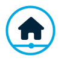

#  dashwise: Your Homelab, in one place


[Extension](https://github.com/dashwise-homelab/chrome) · [Integrations](https://github.com/dashwise-homelab/integrations) · [Frame Companion](https://github.com/dashwise-homelab/framecompanion)

I've been self hosting for a while but did not find a dashboard that suits my needs and that I like the look of.
This is my attempt to solving that.

> **Use of AI:** The development of this project is AI-Assisted by using it as a tool - not as a substitute for real programming skills.

## Screenshot


## Features
- **GUI Editing**: Configure dashwise using its UI. No need to touch config files.
- **Secure by default**: Authentication is built in. Email/password accounts, device logins, and session management all run inside the Dashwise backend — no external identity service required.
- **Dashboards** show Glanceables and Widgets, for example Links (which can be grouped into Link groups and folders)
- **Glanceables**: Customizable bits of one-line information next to the clock.
- **Widgets**: Modular blocks on the dashboard that show key info or actions at a glance. They can be moved and customized individually.
- **News**: Subscribe to RSS feeds to stay on top of everything.
- **Notfications** : Dashwise can receive notifications via PUSH requests to /api/v1/notifications/TOPIC-NAME
- **Spotlight-like Search**: Hit Ctrl+K from your dashboard, and you'll be able to search your links and integrations or use bangs for search engines specified in settings.
- **Integrations**: directly integrates with your favourite self hosted apps. Integrations are defined as YAML files for the widgets, glanceables and shortcuts an integration provides. Refer to [Integrations](https://github.com/dashwise-homelab/integrations) repo for more.

## Installation
For production deployments, use the docker-compose.yaml. It runs a single Go container that serves both the API and the built web app, with data stored in an embedded SQLite database under `./dashwise-data`.

For local development, install dependencies and start the workspace scripts:

```sh
bun install
bun run dev
```

This starts the Go backend (`go run ./cmd/dashwise` from `apps/backend` — needs Go 1.26) and the Vite dev server for the web app.

Upgrading from an older Dashwise (PocketBase-based) install? Export a migration archive from the old app and import it from the Migrate page (`/migrate`) in the new instance. See [Development](docs/Development.md) for details.

## Configuration
See the [configuration reference](docs/Configuration.md) for all supported environment variables.

## Tech Stack
Frontend: React SPA built with Vite
API Layer: Go (single binary, serves API + static frontend)
Backend: Embedded SQLite database with migrations built in
Integrations: TypeScript SDK bundles executed in a Go-embedded JS runtime, plus a Go YAML integration runtime

## How it works
Each user has page-based config records in the `page_configs` SQLite table (for example `home`, `news`, `lab`) plus user-level preferences.
The frontend reads and refreshes page config through the `usePageConfig` hook.

## Open Source Projects that make dashwise possible

[Selfh.st icons](https://github.com/selfhst/icons),
[Font Awesome](https://fontawesome.com),
[Bun](https://bun.sh), [React](https://react.dev), [Shadcn](https://github.com/shadcn-ui/ui)

## Contributions

Feel free to contribute! I'll probably create a more detailed roadmap soon.

### Creating an integration
Refer to [docs/Integrations.md](docs/Integrations.md) for more
